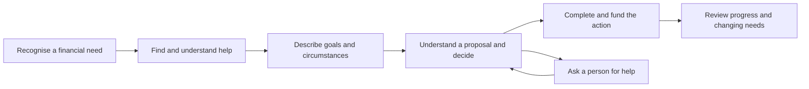

# Using Design Thinking for our wealth-advice challenge

Prepared 10.10.2026. A proposed working method for the team, following the five stages in our course. This is preparation; no stage is marked completed and the coach's exercises take precedence.

The Design Council describes alternating broad exploration with focused decisions, and returning to earlier questions when learning changes the problem. Stanford's Bootleg offers practical tools for understanding people, framing a problem, generating ideas and testing prototypes. Our course combines these into Understand → Empathize & Synthesize → Ideate → Prototype & Test → Business Case & Pitch. [Design Council](https://www.designcouncil.org.uk/resources/framework-for-innovation/), [Stanford Bootleg](https://dschool.stanford.edu/tools/design-thinking-bootleg).

## First divide the customer journey, then choose one problem

“Improve wealth advice for mass-affluent customers” is too large for one classroom prototype. Break it into customer moments. The map below is a proposed investigation framework, not a description of every bank's process.

At each moment, ask what the customer wants, what they do, where they struggle and what evidence supports that account. The final action can include keeping cash, reducing debt, getting specialist help or investing. Avoid defining success as buying a fund regardless of need.

## 1. Understand — establish scope and the current experience

**Question:** Who are we trying to help, and what do we actually know about today's situation?

Bring the challenge question, internal transcript and public examples. Separate notes into **documented public service**, **reported interview observation**, **assumption**, **open question**, and later **team decision**. A published service promise does not prove a customer receives it well.

Use this current-journey worksheet:

| Moment | Customer's intended outcome | Observed action / channel | Friction or unanswered question | Evidence and market | Missing fact |
|---|---|---|---|---|---|
| Recognise need | Know what deserves attention | To investigate | To investigate | — | Trigger and context |
| Find help | Know where to start | To investigate | To investigate | — | Advice awareness |
| Describe circumstances | Explain situation without repetition | To investigate | To investigate | — | Forms, time, repeated information |
| Decide | Understand fit, cost and downside | To investigate | To investigate | — | Comprehension and alternatives |
| Complete | Carry out the agreed action | To investigate | To investigate | — | Funding/signing friction |
| Review | Know whether something needs changing | To investigate | To investigate | — | Actual follow-up promise |

**A candidate focus:** Premium customers in one network market who have regular surplus, are considering investing, and struggle at the recommendation/decision stage. Confirm the group with the team; do not equate them with every customer investing €200.

**Output:** market and customer scope; current journey with source labels; key stakeholders; prioritized unanswered questions. Record agreed outcomes in [01-understand.md](../stages/01-understand.md). Keep its final fields unfilled until the team agrees.

## 2. Empathize & Synthesize — learn from actual experiences

**Question:** What matters to these people, and why does the current experience fail them?

Stanford's interview guidance favours specific experiences and stories over general claims about what people usually do. Its prototype guidance also treats testing as a way to learn about users and revise the problem. The questions below are our application to this challenge, rather than a copied interview script. [Bootleg PDF: interview pages 19–20 and testing pages 55–56](https://dschool.sfo3.digitaloceanspaces.com/documents/dschool_bootleg_deck_2018_final_sm2-6.pdf).

### Suggested customer conversation — about 20 minutes

1. Tell me about the last time you had savings and needed to decide what to do with them.
2. What were you trying to achieve, and when did you need the money?
3. Walk me through what you did, from the first thought to the outcome.
4. Where did you look for help? What made you trust or question it?
5. At which point were you uncertain or stopped? What happened next?
6. If you received a proposal, how did you decide whether it fitted your situation? What did you understand about cost and possible loss?
7. Did you speak to a person? What did they help with, and did you have to repeat yourself?
8. What have you done since? How would you know that your plan needs a review?
9. If you used another provider, what happened that led you there?
10. What is one thing you wish had been different in that experience?

Let the person describe problems before showing ideas. Someone who has never had an adviser should not be asked to rate “their wealth adviser.” Ask about actual help received instead. Do not collect unnecessary account details for the classroom exercise.

### Banker / expert questions

- Describe the last customer who needed help with an investment decision. What took most time?
- What advice is available to standard, Premium and private customers here? What are the exact differences in scope?
- Where do customers abandon the process, and what measurement supports that?
- What does the existing robo-advice journey cover? Does it consider the entire portfolio or individual instruments?
- How is human help requested, what information transfers, and what happens when the banker is unavailable?
- What ongoing review was promised, and who is responsible for it?
- Which tasks require qualified judgement, and which are repeated administration?
- What feedback explains why customers invest elsewhere?

For a small workshop, try to include different experiences: a non-investor considering a first decision, a current investor, and someone who used a competitor or stopped. A few interviews expose questions; they do not establish how common a problem is. If only colleagues role-play, label the feedback as proxy evidence.

### Synthesize without inventing a persona

Capture what was said or observed, then your interpretation. Cluster recurring needs and contradictions. Write an insight as **need + reason + evidence**. For example, if interviews support it: “Customers need an explanation linked to their goal because a risk label alone does not help them judge whether they can afford a loss.”

Draft problem statement format:

> [Specific customer] needs [an outcome] when [a situation], because [evidence-backed difficulty], leading to [consequence].

Illustrative statement, not a finding:

> A first-time Premium investor needs to understand why a proposed investment fits their goal before committing, because the current explanation leaves them uncertain about access to money and possible loss.

**Output:** traceable observations, 2–3 insights, one focused problem and a “How might we” question. A good question leaves room for several solutions: “How might we help a first-time investor understand a recommendation well enough to make an informed decision?”

## 3. Ideate — explore different ways to meet the same need

**Question:** What different services could meet that need?

Start with the agreed problem. Give everyone quiet writing time, then share and combine ideas. Explore human service, communication and process changes alongside digital tools. Use the [candidate improvements](02-mass-affluent-customers-bank-services-and-retention.md) as prompts after the team has generated its own ideas.

For the example problem, competing concepts could be a one-page explanation, a short banker conversation, an interactive scenario exercise, or a clearer proposal screen. An AI assistant is another candidate if the problem and delivery constraints justify it.

Write a concept card with: target user, moment, benefit, how it works, what already exists, main assumption and simplest test. Compare concepts on customer relevance, evidence, feasibility, operational cost and advisory responsibilities. Do not let an attractive technical idea outrank an unaddressed customer need.

**Output:** 2–3 concepts to compare, then a chosen experiment. Selection is provisional; testing can change it.

## 4. Prototype & Test — test one uncertain assumption

**Question:** Does the idea help the person in the way we expect?

A prototype can be paper screens, a one-page summary or a role-play. Build just enough for the user to attempt a task. All cases and recommendations are fictional.

| Hypothesis to test | Prototype | User task | Evidence to record |
|---|---|---|---|
| Clearer rationale improves understanding | Existing-style versus revised explanation | Explain why the option fits the fictional goal, its cost, downside and limitations | Correct/incorrect explanations; missing information |
| Context transfer improves support | Help request plus banker summary | Ask for help, then continue with a banker | Information repeated; questions resolved; time |
| Goal view creates useful next action | Paper progress dashboard | Decide what to review after contributions or goal change | Interpretation; confidence versus understanding |
| Health check helps prioritize | Conversation outline and action sheet | Identify the next financial question to address | Relevance; clarity; scope and time |

Before testing, write an explicit rule. Example for an exploratory classroom test: “In five sessions, at least four people can explain the key trade-off without prompting, and nobody interprets the illustrative outcome as guaranteed.” This is a proposed learning threshold, not statistical proof or live-service approval.

Observe what users do. Ask them to explain their understanding. Capture failures and differences between versions, then change the prototype or revisit the problem. “Would you use this?” is weaker evidence than completing a task correctly. A classroom test cannot demonstrate long-term retention or real financial outcomes.

**Output:** tested assumption, observations, changes and remaining uncertainty.

## 5. Business Case & Pitch — explain value and the next experiment

**Question:** Is there a credible way to deliver this, and what should happen next?

Describe the customer, observed problem, proposed service and tested learning. Show how it works with existing bank capabilities. Identify delivery owners: customer/channel team, advisers, operations, investment/product specialists, and the responsible control functions where relevant.

Use both customer and bank measures:

| Customer value | Operational / business value |
|---|---|
| Understanding fit, cost and downside | Adviser time per completed case |
| Reaching a useful next action | Completion and avoidable repeat contacts |
| Less repetition at handover | Cases resolved and time waiting for help |
| Knowing when to review | Reviews completed and reasons for changes |
| Confidence supported by comprehension | Incremental net contribution after costs |

Present retention as a longer-term hypothesis with a baseline, comparison and follow-up period. Do not claim five prototype users prove lower churn. Include costs of development, integration, support, training and maintenance, not only software creation.

A simple pitch sequence: customer and moment → evidence of pain → concept demonstration → what the test taught us → benefits and costs → next pilot and measures. The ask can be permission to run a small pilot, rather than permission to build a full platform.

**Output:** a credible case with uncertainty made visible and a specific next step.

## A proposed 45-minute team alignment exercise for 13.10.2026

Use this only if useful alongside the coach's agenda.

- **0–5 minutes:** read the exact challenge and distinguish mass affluent from Premium.
- **5–15:** select a provisional market/user and review documented versus assumed services.
- **15–25:** sketch the current journey; mark the evidence and missing facts.
- **25–35:** identify 2–3 moments to investigate; keep solution suggestions in a separate ideas area.
- **35–45:** agree what customer/expert evidence is needed and who will gather it.

End with a research focus, not a predetermined app. Arianit's facilitation practice can be helping the team distinguish evidence, assumptions and choices while making space for everyone's contribution.
