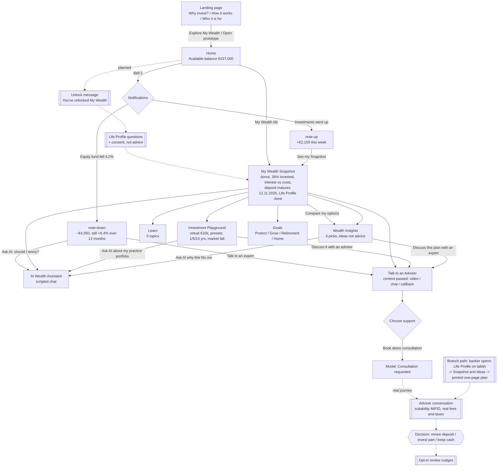

# 4.2.1 Storyboard & User Flow — My Wealth

RBI AI Prompt Library prompt 4.2.1, run 15.10.2026 with skill innovation-prototype-test. AI-assisted draft for the team. Prototype: ../../prototype/my-wealth-prototype.html

> **Evidence limits.** The main character is the provisional persona **Self-Directed Comparer**, based on one street interview (C1). C1's age, job, amounts and bank are **not known**. The €437,000 and €120,000 figures are the prototype's fictional demo data, used here as an illustrative scenario, not C1's real situation. Quotes in frames 1–2 are from the C1 transcript; all later thoughts and speech are **illustrative**. The C2 variant is based on one interview (C2), and its branch path is **not yet in the prototype**.

---

## Filled prompt

```text
I need to create a storyboard that visualizes how customers will experience my solution.

MY SOLUTION:
"My Wealth" for Raiffeisen Bank International, scope Hungary, for mass-affluent customers outside full Premium advice. A new section inside the existing mobile app (My Life in Hungary), unlocked when the customer enters the mass-affluent segment. Flow: threshold reached → unlock My Wealth → Life Profile → Learn / Investment Playground → AI if wanted → expert if needed → real investment or advice → ongoing reviews. Screens in the clickable prototype: Home (€437,000) with a notification bell (2 notifications: investments up; Global Equity Fund down, each with a detail screen); My Wealth Snapshot (current account €42k, savings & deposits €238k, investments €157k; 36% invested; interest €2,380 and investment costs €1,880 per year; nudge: €120,000 term deposit matures 12.11.2026, "No pressure: keeping it is fine too"; Life Profile done: "You value stability, have a 5–10 year horizon and want to grow savings"); Learn (5 topics); Investment Playground (virtual €10k portfolio, 1/5/10-year range, market-fall test); scripted AI Wealth Assistant; Goals; Wealth Insights (4 picks: cash cushion €50k; bond fund & government bonds €150k as top idea; balanced fund €80k; keep current investments €157k; "Ideas, not personal advice"); Talk to an Adviser (context passed; video / chat / callback; booking). All demo data. Rules: AI explains, banker recommends (MiFID II); AI discloses itself (AI Act, from 02.08.2026); GDPR consent; no cold calls; not digital-only; success = a confident, suitable decision, not "invest more".

TARGET PERSONA:
Main: "The Self-Directed Comparer" (from street interview C1). Invests long-term on their own (ETFs for about 2 years), with a nephew and ChatGPT as advisers. Cancelled the bank investment account this year because of cost; felt bank guidance was "more of a product push", not clear and not personal; had to fit the adviser's schedule. Prefers digital with immediate support; would share life context; would come back for "more personalised… and cheaper". Age, job and amounts not known.
Variant: "The Cautious Branch Saver" (from street interview C2). Long-time saver; trusts the branch and self-initiated contact; rejects phone, internet and ad offers; relies on other people's information.

SPECIFIC SCENARIO:
A €120,000 term deposit matures on 12.11.2026. The customer has €437,000 with the bank, mostly in cash (savings, deposits, current account). They open My Wealth to decide what to do with the deposit.

Help me create a compelling storyboard:

1. STORYBOARD PURPOSE & GOALS
   - What story are we telling?
   - What should viewers understand after seeing this?
   - What emotions should it evoke?
   - Who is the audience? (stakeholders, designers, developers, customers)

2. NARRATIVE STRUCTURE
   Recommend story arc:
   - Setup: Show the problem/need (current pain)
   - Introduction: Customer encounters the solution
   - Journey: Customer uses the solution
   - Resolution: Customer achieves goal
   - Reflection: Customer's life improved

3. STORYBOARD SCENES/FRAMES
   Create detailed scene-by-scene breakdown:

   For each scene, specify:
   - Scene number
   - Setting/context (where is customer, what are they doing)
   - Visual description (what should be drawn/shown)
   - Character action (what customer does)
   - UI elements visible (if showing app/web)
   - Customer's thought (thought bubble text)
   - Customer's emotion (happy, frustrated, relieved, etc.)
   - Narrative caption (text description below frame)

   Typical structure (8-12 frames):
   - Frame 1: Problem/pain point in current state
   - Frame 2: Customer discovers solution
   - Frame 3-8: Step-by-step through solution experience
   - Frame 9-10: Success/goal achieved
   - Frame 11-12: Positive outcome/benefit

4. CHARACTER DEVELOPMENT
   - Use specific persona (name, appearance based on persona)
   - Consistent character throughout frames
   - Expressive emotions (facial expressions, body language)
   - Relatable situation

5. VISUAL STYLE GUIDANCE
   Since I may not be artistic:
   - Can use stick figures (focus on story, not art)
   - Simple icons and symbols
   - Arrows to show flow and interaction
   - Thought bubbles and speech bubbles
   - Emotion indicators (😊, 😟, etc.)
   - UI mockup snippets (simple rectangles for screens)

6. KEY MOMENTS TO HIGHLIGHT
   What to emphasize:
   - The "aha moment" when solution makes sense
   - Moments of delight or relief
   - Contrast: before (painful) vs. after (smooth)
   - The core value proposition in action

7. DIALOGUE & CAPTIONS
   - Thought bubbles: What customer is thinking
   - Speech bubbles: What customer or system says
   - Captions: Narrative description of each frame
   - Keep text minimal and impactful

8. FEEDBACK & ITERATION PROMPTS
   - What questions to ask when reviewing storyboard?
   - "Does this resonate with actual customer pain?"
   - "Is the value proposition clear?"
   - "Would customers recognize themselves?"
   - "What's confusing or missing?"

9. TOOLS & FORMATS
   Recommend tools:
   - Hand-drawn on paper (scan/photo)
   - PowerPoint with shapes
   - Google Slides
   - Specialized tools (Storyboarder, Boords)
   - Digital whiteboard (Miro, Mural)

10. ALTERNATIVE FORMAT: USER FLOW DIAGRAM
    If storyboard feels too complex, suggest user flow:
    - Flowchart showing decision points
    - Boxes for screens/steps
    - Arrows for navigation
    - Diamond shapes for decisions
    - Annotations for key interactions

OUTPUT FORMAT:
Detailed frame-by-frame storyboard specification with:
- 8-12 frames fully described
- Visual guidance for each frame
- All text/dialogue/captions
- Character emotions and thoughts
- Guidance on how to draw/create it
```

---

## Output

### 1. Storyboard purpose & goals

- **Story:** a self-directed customer, used to deciding with family and ChatGPT because the bank felt like a product push, faces a real money moment (a maturing €120,000 deposit). With My Wealth they see their own position and costs, explore clear ideas, and choose to talk to an expert who already knows their context. They make a confident decision **with their bank**.
- **Viewers should understand:** My Wealth starts from the customer's situation, makes numbers and costs clear, keeps AI to explanations, and hands over to a human when the customer asks. The outcome can be "invest part" or "keep it": the point is confidence and suitability.
- **Emotions:** recognition of the pain (frames 1–2), curiosity and relief (frames 3–7), control and confidence (frames 8–11).
- **Audience:** our team and coaches (pitch on 04.11.2026), test participants (as a concept-test stimulus), and RBI stakeholders (business, Compliance) later.

### 2. Narrative structure

| Arc | Frames | Content |
|---|---|---|
| Setup | 1–2 | Product push, cost, ChatGPT and the nephew; the deposit is ending |
| Introduction | 3 | My Wealth invitation in the app (unlock) |
| Journey | 4–8 | Snapshot and costs, deposit nudge, notification wobble, Wealth Insights, AI question |
| Resolution | 9–10 | Talk to an Adviser with context passed; conversation and decision |
| Reflection | 11 | Calm review months later; the bank is part of the decision again |

### 3. Storyboard frames (main persona: Self-Directed Comparer)

Character name for the boards: **"Alex"** (a label, not a real person; gender, age and job deliberately left open, as in the persona).

**Frame 1 — The old way: product push and cost**
- **Setting:** Alex at a bank desk earlier this year, then at home with a fee statement.
- **Visual:** split frame. Left: an adviser pointing at a product leaflet, a calendar with few free slots. Right: Alex holding a statement with a big "€" and a cancel stamp.
- **Action:** Alex cancels the bank investment account.
- **UI:** none (paper statement).
- **Thought:** "It was not too personalised… more of a product push." (C1, transcript) / "It costs too much money." (C1)
- **Emotion:** frustrated, let down.
- **Caption:** "The bank asked why Alex was leaving, and offered nothing."

**Frame 2 — Deciding elsewhere**
- **Setting:** Alex on the sofa with a laptop, phone call with the nephew.
- **Visual:** laptop with a chat window labelled "ChatGPT", phone speech bubble from the nephew; a bank letter on the table: "Your €120,000 term deposit matures on 12.11.2026".
- **Action:** Alex pastes a fund list into ChatGPT and asks what to do with the money.
- **Thought:** "I think it's really bad, but I use ChatGPT for that." (C1, transcript)
- **Emotion:** unsure, a little guilty.
- **Caption:** "Big money decision. The bank is not in the room."

**Frame 3 — The invitation (unlock)**
- **Setting:** Alex on the tram, phone in hand.
- **Visual:** phone with the bank app Home: "Hello… Available balance €437,000", a new tile "My Wealth — Guidance, learning & investing". (Unlock message as planned in the concept: "You've unlocked My Wealth: a new way to understand, plan and manage your money." *This message is not yet a screen in the prototype.*)
- **Action:** Alex taps My Wealth.
- **Thought:** "Another sales pitch? …Let's see." (illustrative)
- **Emotion:** sceptical but curious.
- **Caption:** "No call, no ad. Alex opens it when Alex wants to."

**Frame 4 — Life Profile: starting from my life**
- **Setting:** Alex at home in the evening.
- **Visual:** phone with 6 simple question cards (what are you saving for, when do you need the money, access, comfort with losses, experience, stability or growth), then the result: "You value stability, have a 5–10 year horizon and want to grow savings." Small note: "This is not investment advice." *(Questions not yet in the prototype; the prototype shows the profile as "Done".)*
- **Action:** answers in about 3 minutes (illustrative).
- **Thought:** "Finally someone asks about my plans, not just a questionnaire." (illustrative, based on C1's wish)
- **Emotion:** engaged.
- **Caption:** "The bank starts from Alex's life, not from a product."

**Frame 5 — The Snapshot: aha moment**
- **Setting:** same, Alex leans in toward the phone.
- **Visual:** My Wealth Snapshot screen: donut (current account €42,000, savings & deposits €238,000, investments €157,000), bar "Not invested €280,000 · 64% / Invested €157,000 · 36%", tiles "Interest on deposits €2,380 · about 1%" and "Investment costs per year €1,880 · 1.2%", "Emergency buffer ✓ 6+ months covered".
- **Action:** Alex reads the cost tile twice.
- **Thought:** "So that's what I pay, and most of my money earns about 1%." (illustrative)
- **Emotion:** surprised, then clear-headed. **Aha moment.**
- **Caption:** "For the first time, Alex sees everything in one place, including the cost."

**Frame 6 — The deposit nudge**
- **Setting:** close-up of the phone.
- **Visual:** yellow card: "🔔 Your €120,000 term deposit matures on 12.11.2026. Renew it, or compare other options first. No pressure: keeping it is fine too." Button "Compare my options".
- **Action:** Alex taps "Compare my options".
- **Thought:** "No pressure. Good." (illustrative)
- **Emotion:** relaxed.
- **Caption:** "A reminder at the right moment, with no push."

**Frame 7 — A wobble: the notification**
- **Setting:** next morning, coffee; phone shows the bell with "2".
- **Visual:** notification list: "📈 Your investments went up +€2,150" and "📉 Global Equity Fund fell 4.2% −€4,050". Detail screen: "Still up over 12 months ▲ +6.4%… Selling after a fall locks in the loss. If you're worried, talk it through first." Buttons "Ask AI: should I worry?" and "Talk to an expert".
- **Action:** Alex opens the "fell 4.2%" notification.
- **Thought:** "Should I move everything to bonds now?" then "OK, my horizon is 5–10 years." (illustrative)
- **Emotion:** worried, then calmer.
- **Caption:** "Bad news explained in context, not hidden."

**Frame 8 — Wealth Insights: clear ideas, not orders**
- **Setting:** at the desk, Alex with a notepad.
- **Visual:** Wealth Insights screen: headline "€280,000 is sitting in cash, earning about 1%…"; allocation bar Cash / Bonds / Balanced / Current; 4 cards: "Keep a cash cushion €50,000", "Bond fund & government bonds €150,000 — use the €120,000 deposit maturing 12.11.2026, plus €30,000 cash" (Top idea), "Balanced fund €80,000", "Keep your current investments €157,000 — check you're not paying too much (€1,880/yr)". Footer: "Ideas, not personal advice… An adviser checks suitability (MiFID), real fees and taxes before you decide."
- **Action:** Alex writes down the bond idea and a question about fees and taxes.
- **Thought:** "This is clearer than my ChatGPT answer. But is it right for me?" (illustrative)
- **Emotion:** interested, cautious.
- **Caption:** "Ideas with the why, the risk and the cost, clearly marked as ideas."

**Frame 9 — Asking the AI (optional)**
- **Setting:** same.
- **Visual:** AI Wealth Assistant chat. Alex: "Why keep cash?" AI: "Keeping cash can be sensible for emergencies and near-term needs. The goal is not to invest everything." Footer: "AI explains and explores options… A real personal recommendation would require suitability checks and the approved advisory process." *(A clear "I am an AI" line is planned for the AI Act; the prototype currently shows it only in the title and footer.)*
- **Action:** asks one or two questions instead of going to ChatGPT.
- **Thought:** "Good explanation. For the decision I want a person." (illustrative)
- **Emotion:** reassured.
- **Caption:** "AI explains. A banker recommends."

**Frame 10 — Talk to an expert, without starting from zero**
- **Setting:** Alex chooses a time that suits them, e.g. a lunch break.
- **Visual:** Talk to an Adviser screen: "The adviser receives your goal, completed learning, questions and explored ideas so you do not start from zero." Options: Video consultation 15–20 min, Chat with expert (on demand), Request callback (today). Modal: "Consultation requested." Then a small video window with an adviser who already has Alex's Snapshot and Insights on screen.
- **Action:** books a video consultation; the adviser does the suitability check and explains real fees and taxes.
- **Speech (adviser, illustrative):** "I see you're looking at the bond idea for your €120,000 deposit. Let's check it against your plans."
- **Thought:** "On my schedule, and I don't have to explain everything again." (illustrative; contrast with C1: "I had to adjust my life around the availability of the adviser")
- **Emotion:** respected, confident.
- **Caption:** "Human help when Alex asks for it, with the context already there."

**Frame 11 — Confident decision, and the bank is back in the room**
- **Setting:** a few months later; Alex on the sofa again, laptop closed, phone shows My Wealth.
- **Visual:** a ticked checklist: "Cash cushion kept ✓", "Decision on €120,000 made with adviser ✓", "Review in 12 months 🔔 (opt-in)". The nephew on the phone: "So what did you do?" Alex: "I talked it through with my bank, and I know what I pay."
- **Thought:** "I decided, and I understand why." (illustrative)
- **Emotion:** calm, in control.
- **Caption:** "Success is a confident, suitable decision. Investing part or keeping the deposit can both be right."

### 4. Character development

- **Alex (Self-Directed Comparer):** stick figure with a laptop bag and phone; always the same small sign (e.g. headphones) so viewers recognise them. Body language: arms crossed in frames 1–3, leaning forward in 5 and 8, relaxed in 10–11.
- **Supporting characters:** the nephew (phone speech bubble only), the old adviser (frame 1, behind a desk with a full calendar), the new adviser (frame 10, in a video window, with Alex's profile visible).
- **Relatable situation:** a real deadline (12.11.2026), real choices (renew, bonds, funds), real worry (a market fall).
- Do not add age, job or family; the persona does not have them.

### 5. Visual style guidance

- **Stick figures** and simple faces: a straight mouth for unsure, a frown for frustrated, a smile for relieved.
- **Phone screens** as rectangles with only the 2–3 key elements of each prototype screen (e.g. the donut and the cost tile in frame 5). Use RBI yellow for My Wealth screens, grey for the "old way" in frames 1–2.
- **Arrows** between frames 3 → 10 to show one continuous path; a dashed arrow from frame 7 to frame 10 ("talk to an expert" shortcut).
- **Thought bubbles** (cloud) for thoughts; **speech bubbles** for the nephew, the AI and the adviser. Label the AI bubble with "AI".
- **Emotion indicators:** small faces or words in the frame corner (frustrated, unsure, curious, aha, calm).
- Mark "not yet in prototype" frames (3 unlock message, 4 questions) with a small dashed border.

### 6. Key moments to highlight

- **Aha moment:** frame 5, seeing invested vs not invested and the real annual cost in one place.
- **Relief:** frame 6 ("No pressure: keeping it is fine too") and frame 7 (the fall explained, not hidden).
- **Before vs after:** frame 1 (adviser's calendar, product leaflet) against frame 10 (Alex's time, Alex's context). Place them side by side in the pitch.
- **Core value in action:** frame 8 → 10, from clear ideas to a human decision without restarting.

### 7. Dialogue & captions (summary)

| Frame | Thought / speech | Caption |
|---|---|---|
| 1 | "More of a product push." / "It costs too much money." (C1) | The bank asked why, and offered nothing. |
| 2 | "I think it's really bad, but I use ChatGPT for that." (C1) | Big money decision. The bank is not in the room. |
| 3 | "Another sales pitch? …Let's see." | No call, no ad. Alex opens it when Alex wants to. |
| 4 | "Finally someone asks about my plans." | The bank starts from Alex's life. |
| 5 | "So that's what I pay." | Everything in one place, including the cost. |
| 6 | "No pressure. Good." | A reminder at the right moment. |
| 7 | "OK, my horizon is 5–10 years." | Bad news explained in context. |
| 8 | "Clearer than my ChatGPT answer. But is it right for me?" | Ideas, clearly marked as ideas. |
| 9 | AI: "The goal is not to invest everything." | AI explains. A banker recommends. |
| 10 | Adviser: "Let's check it against your plans." | Help when Alex asks, with context. |
| 11 | "I decided, and I understand why." | A confident, suitable decision. |

Frames 3–11 thoughts are illustrative; only the C1 quotes in frames 1–2 are from the transcript.

### 7b. Variant — Cautious Branch Saver (C2), branch path (5 frames)

> **Not yet in the prototype.** This path is fix 3 in `03-ideate.md` (banker opens the same Life Profile on a tablet and prints a one-page plan). Use it as a paper role-play in testing. Character label: **"Kata"** (a label, not a real person; no age or job invented). The €120,000 deposit scenario is illustrative.

**V1 — No to the phone**
- **Visual:** Kata at home ignoring a ringing phone; an online ad crossed out.
- **Thought:** "If it is by telephone, then no." (C2, transcript, translated)
- **Emotion:** distrustful.
- **Caption:** "Offers that come to Kata do not get in."

**V2 — Kata goes to the branch herself**
- **Visual:** Kata walking into a Raiffeisen branch with the deposit letter (12.11.2026).
- **Thought:** "If an offer is made in a bank branch, there is more trust." (C2, transcript, translated)
- **Emotion:** cautious, but on her own terms.
- **Caption:** "Kata starts the conversation, in the place she trusts."

**V3 — The banker opens the Life Profile on a tablet**
- **Visual:** banker and Kata side by side (not across a desk), a tablet with the same Life Profile questions as in the app, in Hungarian. Small note "This is not investment advice" and a consent tick (GDPR).
- **Speech (banker, illustrative):** "Before we talk about products, what is this money for, and when might you need it?"
- **Emotion:** listened to.
- **Caption:** "Same Life Profile as the app, with a person beside her."

**V4 — The same Snapshot and ideas, explained face to face**
- **Visual:** tablet showing the Snapshot (cash vs invested, interest vs costs) and the Wealth Insights picks; the banker points to the cash cushion card first.
- **Thought:** "I can keep my safety money. Good." (illustrative)
- **Emotion:** reassured.
- **Caption:** "The banker explains; Kata decides at her own pace. Keeping the deposit is a valid choice."

**V5 — A printed one-page plan to take home**
- **Visual:** Kata leaving with one printed page: her profile sentence, her position, 2–3 options with risk and cost, the banker's name and a "come back when you are ready" date. No app needed.
- **Thought:** "I'll show this to my family and come back." (illustrative; C2 relies on other people's information)
- **Emotion:** calm, in control.
- **Caption:** "Not digital-only: the same guidance on paper, from a person she trusts."

### 8. Feedback & iteration prompts

Ask the team, coaches and test participants:

- "Does frame 1–2 match the real pain?" (check with C1 quotes; ask participants "Have you experienced this?")
- "At which frame do you understand what My Wealth is for?" (target: frame 5)
- "Does frame 8 feel like ideas or like selling?" (H4)
- "Would you press 'Talk to an expert' in frame 7 or frame 10? Why?" (H5)
- "Would someone like Kata recognise herself in V1–V5? Would she go to the branch for this?" (H6)
- "Is it clear that the AI only explains?" (AI Act, MiFID)
- "What's missing?" Likely gaps: costs comparison deposit vs bond vs fund (fix 1), what happens at the exit (fix 2), the opt-in for customers just below the threshold (fix 4), nudge settings (fix 7).
- "Would customers recognise themselves?" (only 1 interview behind each persona: treat agreement as a first signal.)

### 9. Tools & formats

- **Recommended:** **Miro** (already used in the programme) with 11 + 5 frames in two rows, using screenshots of the actual prototype screens inside the phone rectangles. Easy for remote homework and for the pitch.
- **Fast alternative:** hand-drawn on A4 (stick figures), photographed and added to Miro. Good for street testing: show frames 1–2 and ask "Is this you?"
- **For the pitch:** **PowerPoint** with shapes, 1 slide per 3–4 frames, with frames 1 and 10 side by side as before/after.
- Specialised tools (Storyboarder, Boords) are not needed for this stage.

### 10. User flow diagram (actual prototype screens)

Screen IDs are those in `my-wealth-prototype.html`. Items in `[[ ]]` are **not yet built**.



**Navigation notes**

- Bottom navigation bar is always visible in the app: Home, My Wealth, Learn, Adviser. So "Talk to an Adviser" is reachable from every screen (one tap).
- Every My Wealth sub-screen has "← My Wealth"; notification details go back to My Wealth.
- Decision points (diamonds): which notification to open; which support channel; the final decision (outside the prototype).
- Not built yet: unlock message, Life Profile questions and consent, real adviser hand-over, decision and review nudges with settings, exit moment (fix 2), branch path, and a clear "I am an AI" line in the chat.

---

## What this means for our test

- Use **frames 1–2** as a quick check in street tests ("Is this you?"). If participants do not recognise the product push and the ChatGPT / family workaround, our problem framing is weak, not only the prototype.
- The story depends on two screens that **do not exist yet**: the unlock message (frame 3) and the Life Profile questions (frame 4). Add them as paper cards for round 2, or the test skips the start of the journey.
- **Frames 5, 8 and 10** carry the value (clear position and cost, ideas not orders, human help with context). Make them tasks 2, 3–4 and 6 in the testing strategy (4.1.1), and watch for any "selling" reaction at frame 8.
- The **C2 branch variant** is the way to test the "not digital-only" guardrail without building anything: a paper or tablet role-play with at least two C2-type participants.
- All thoughts after frame 2 are our assumptions. Replace them with real participant quotes after round 2, analysed with prompt 4.3.3.
